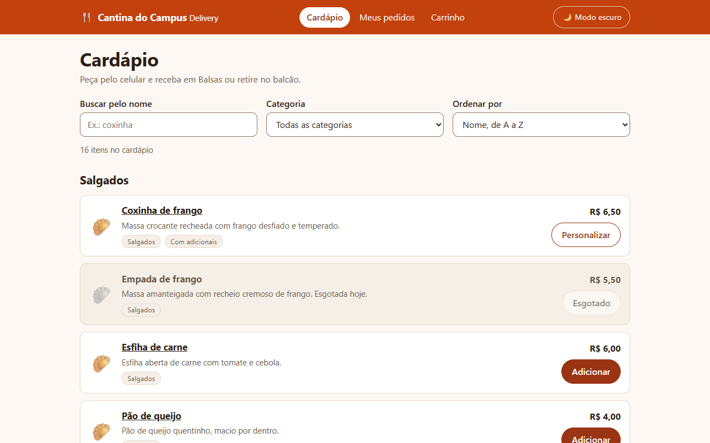
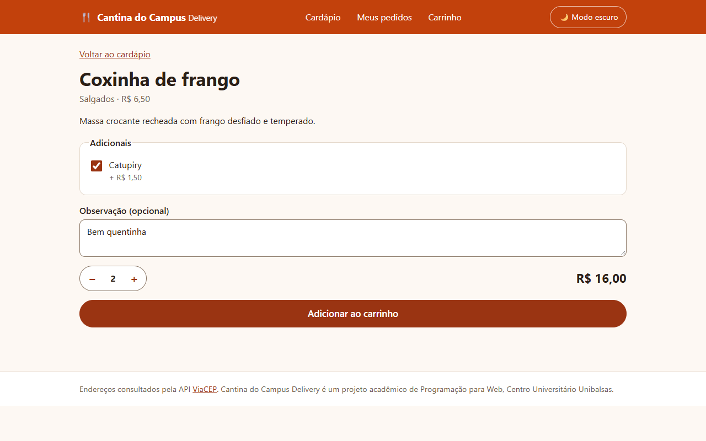
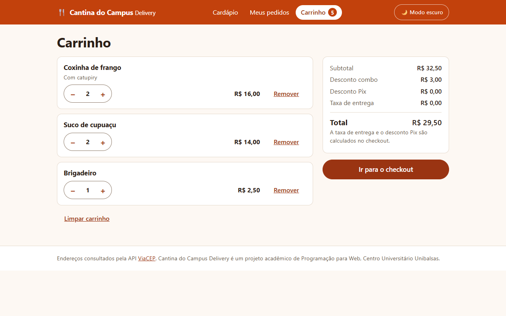
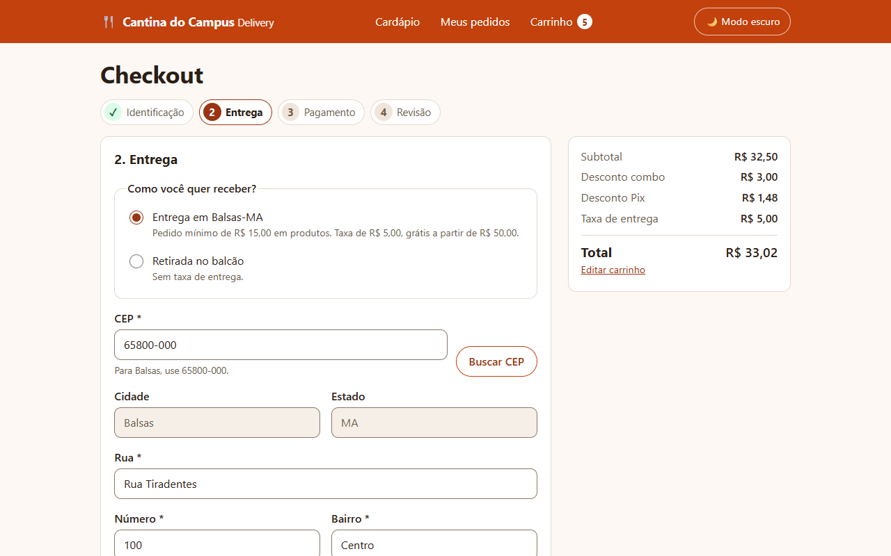
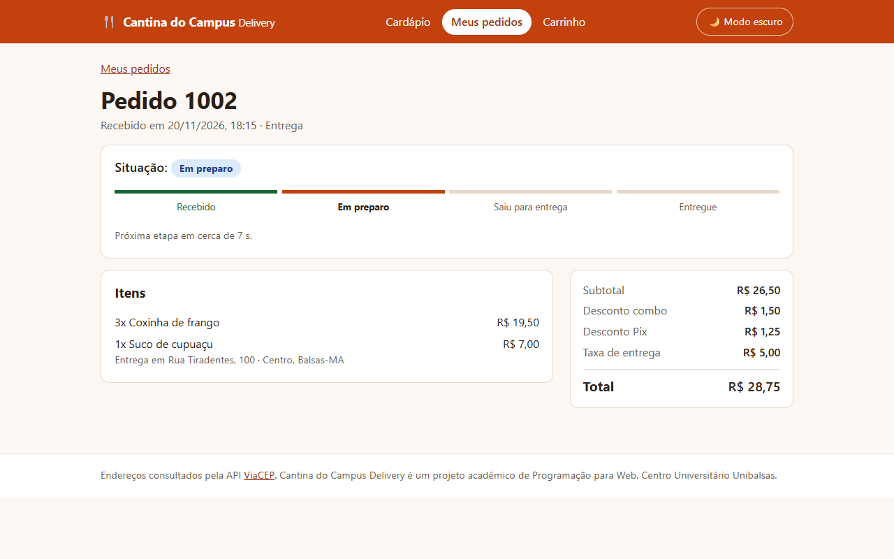
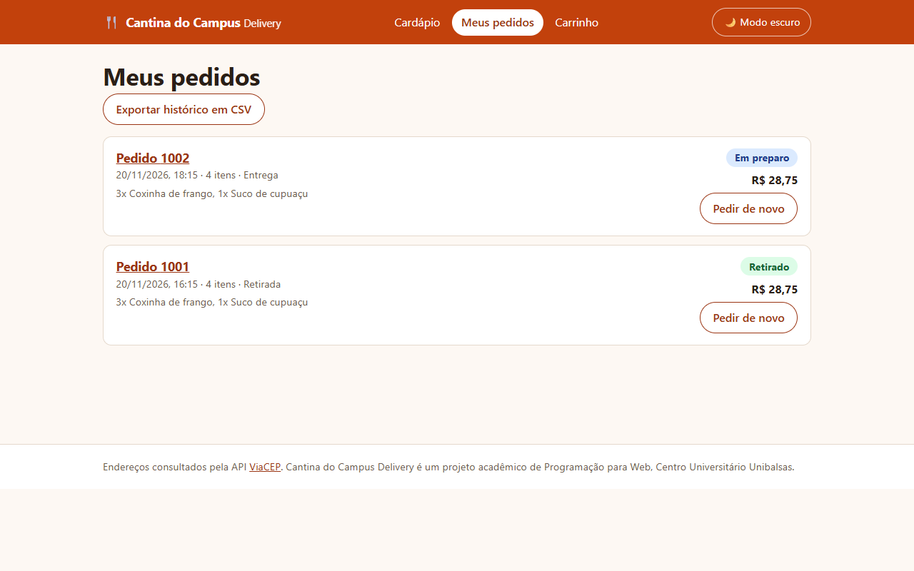

# Cantina do Campus Delivery

Loja completa da cantina do campus: cardápio com adicionais, carrinho, checkout em quatro etapas, entrega por CEP (ViaCEP) e acompanhamento de pedido que avança sozinho.

**Aplicação publicada:** https://jackfrost232.github.io/cantina-campus-delivery/
**Tema:** C (Cantina do Campus Delivery)

## Equipe

| Integrante | Responsável por |
| --- | --- |
| Pedro Paulo Teixeira de Araujo | Todas as partes: tipos, regras de negócio e testes (`src/dominio`, `src/testes`), serviços e ViaCEP, contextos, telas, checkout, estilos e publicação |

Projeto feito individualmente, com autorização do professor.

## Como rodar

```bash
npm install
npm run dev      # servidor de desenvolvimento
npm test         # 66 testes das regras de negócio (Vitest)
npm run build    # verifica tipos e gera a versão de produção em dist/
npm run lint
```

## Telas

| Rota | Tela |
| --- | --- |
| `/` | Cardápio: por categoria, com filtro, busca, ordenação e itens esgotados desativados |
| `/itens/:id` | Detalhe do item: adicionais, observação, quantidade e preço da linha recalculado |
| `/carrinho` | Carrinho com + e −, remoção e resumo de valores |
| `/checkout` | Identificação, entrega, pagamento e revisão |
| `/pedidos/:numero` | Acompanhamento, com cancelamento enquanto estiver Recebido |
| `/pedidos` | Histórico, com Pedir de novo |
| qualquer outra | Página de não encontrado com link para o início |

### Capturas de tela

**`/` Cardápio**



**`/itens/:id` Detalhe do item** (coxinha com catupiry, 2 unidades: R$ 16,00)



**`/carrinho` Carrinho**



**`/checkout` Checkout, etapa Entrega** (CEP 65800-000 com Balsas-MA preenchido e rua e bairro digitados)



**`/pedidos/:numero` Acompanhamento** (pedido em preparo, total do cenário C03: R$ 28,75)



**`/pedidos` Meus pedidos**



## Regras de negócio

Todas são funções puras em `src/dominio`, sem React e sem `localStorage`.

| Regra | Arquivo | Teste |
| --- | --- | --- |
| C1 dinheiro em centavos, `Math.round`, formato `R$ 28,75` | `formatos.ts` | `formatos.test.ts` |
| C2 carrinho com `useReducer` e ações tipadas | `carrinho.ts` (reducer), `contexto/CarrinhoProvider.tsx` | `carrinho.test.ts` |
| C3 linhas iguais, quantidade de 1 a 10, preço da linha | `carrinho.ts` | `carrinho.test.ts` |
| C4 combo de R$ 1,50 por par salgado + bebida | `precos.ts` | `precos.test.ts` |
| C5 entrega: só Balsas-MA, mínimo de R$ 15,00, taxa R$ 5,00 (grátis a partir de R$ 50,00), endereço obrigatório | `entrega.ts`, `precos.ts`, `checkout.ts` | `entrega.test.ts`, `precos.test.ts`, `checkout.test.ts` |
| C6 pagamento: Pix 5% só sobre produtos, cartão, dinheiro com troco; os cinco valores do resumo | `precos.ts`, `pagamento.ts` | `precos.test.ts`, `entrega.test.ts` |
| C7 situação do pedido a cada 10 s, calculada pelo tempo (`situacaoDoPedido`), cancelamento só em Recebido | `pedido.ts` | `pedido.test.ts` |
| C8 pedir de novo, ignorando esgotados | `pedirDeNovo.ts` | `pedido.test.ts` |

## Cenários de aceitação

Os cenários C01 a C08 e C10 a C12 estão cobertos por testes automáticos. Os demais dependem da tela e foram pensados para conferir à mão:

| Cenário | Como conferir |
| --- | --- |
| C09 | No checkout, escolher Entrega e buscar o CEP `65800-000`: cidade Balsas e estado MA preenchidos, rua e bairro liberados para digitar |
| C11 | Buscar o CEP `99999-999`: "CEP não encontrado" (a API responde 200 com `erro`) |
| C13 | Usar o nome `erro` na identificação e confirmar: mensagem de falha, carrinho intacto |
| C14 | Confirmar um pedido: abre `/pedidos/:numero`, mostra Recebido e avança a cada 10 s. O botão Cancelar some em Em preparo. Recarregar no meio do caminho não reinicia o pedido |
| C15 | Fazer um pedido com um item e depois marcar esse item como `"disponivel": false` em `public/dados/cardapio.json`. Em Meus pedidos, "Pedir de novo" repõe os demais e cita o que ficou de fora |
| RC09 | No console: `localStorage.setItem('cantina:carrinho', 'isso nao e json')` e recarregar. A aplicação abre com o carrinho vazio |
| RC07 | No F12, aba Rede, marcar Offline e recarregar: aparece o erro com Tentar de novo |

Em 20/11/2026 os cenários C01 a C15 foram conferidos também na tela da versão publicada, todos com o resultado da tabela do enunciado, além da navegação só por teclado (pular para o conteúdo, adicionar item e avançar no checkout com Tab e Enter, com foco visível), da largura de 360 px em todas as rotas e de uma verificação automática de acessibilidade (axe-core, WCAG 2.1 AA) sem violações nos temas claro e escuro.

## Decisões técnicas

- **Estado compartilhado em três contextos:** `CardapioProvider` (busca única do cardápio, com Tentar de novo), `CarrinhoProvider` (`useReducer`, persistido em `cantina:carrinho`) e `PedidosProvider` (histórico em `cantina:pedidos`). Cada um tem um hook próprio: `useCardapio`, `useCarrinho`, `usePedidos`.
- **O reducer fica em `src/dominio/carrinho.ts`** porque é uma função pura e precisa de teste. O Context só o liga ao `useReducer` e grava no `localStorage`.
- **A situação do pedido não é estado.** O pedido guarda `recebidoEm`, e `situacaoDoPedido(pedido, agora)` calcula a etapa. O hook `useAgora` só atualiza o relógio a cada segundo, com `clearInterval` na limpeza do efeito.
- **Servidor simulado:** `enviarPedido` (em `src/servicos/pedidos.ts`) espera 1,5 s, numera a partir de 1001 de forma persistente e falha quando o nome é `erro`.
- **ViaCEP:** o formato é validado antes da chamada, o campo `erro` da resposta é conferido e rua e bairro vazios (CEP único de Balsas) ficam editáveis. Buscas antigas são canceladas com `AbortController`.
- **Leitura defensiva:** `src/dominio/validadores.ts` confere o formato de tudo que volta do `localStorage` e do JSON do cardápio.
- **Foco e teclado:** o foco vai para o primeiro campo inválido e, ao trocar de etapa, para o título da etapa. Há link de pular para o conteúdo (um botão, porque âncora `#` quebraria o `HashRouter`).
- **`HashRouter` e `base: './'`:** o mesmo build funciona na raiz do domínio e em subpasta do GitHub Pages, e recarregar qualquer rota funciona.
- **Sem bibliotecas além de `react-router-dom` e `vitest`.**

## Diferenciais

- **Modo escuro:** botão no cabeçalho (`useTema`). Na primeira visita segue a preferência do sistema (`resolverTema` em `src/dominio/tema.ts`) e a escolha fica em `cantina:tema`.
- **Exportação em CSV:** em Meus pedidos, "Exportar histórico em CSV" gera o arquivo com `pedidosParaCsv` (`src/dominio/exportacao.ts`), com `;` e BOM para abrir direto no Excel em português.

## Créditos

- Endereços: [ViaCEP](https://viacep.com.br/) (sem chave, sem atribuição obrigatória; creditada no rodapé).
- Projeto acadêmico de Programação para Web, Centro Universitário Unibalsas, prof. Marcos David Souza Ramos.
